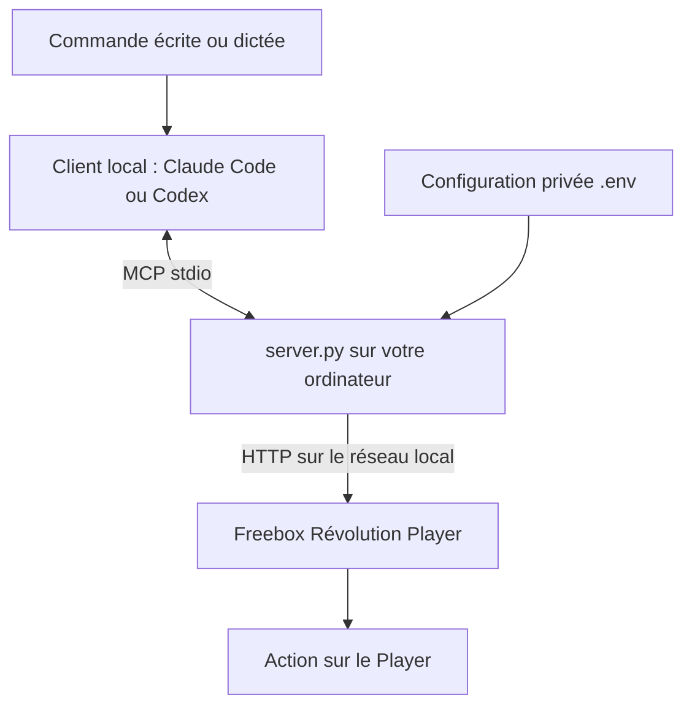

# Freebox MCP

Contrôlez un **Freebox Révolution Player** depuis un client MCP, avec des commandes comme « baisse le volume » ou « passe à la chaîne 2 ».

Le serveur Python fonctionne sur votre ordinateur et communique avec le Player sur le réseau local. Claude Code est un client possible ; les scripts de test fonctionnent aussi sans lui.

## Architecture



Le client interprète la demande et choisit un outil ; `server.py` valide les paramètres et envoie la commande au Player. Le code de télécommande reste dans la configuration locale. Le serveur n’intègre aucun modèle d’IA ni reconnaissance vocale.

| Mode | Ce qu’il faut |
|---|---|
| Claude | Claude Code installé et connexion MCP configurée ci-dessous. |
| OpenAI | Codex local configuré en MCP, ou une application API à développer. |
| Voix | Dictée du système vers un client local, ou application vocale à développer. |

L’ordinateur doit rester allumé et connecté au même réseau local que la Freebox. Le client peut utiliser Internet pour interroger son modèle, mais l’envoi des commandes au Player reste local.

## Conditions

- Un **Freebox Révolution Player** allumé.
- **L’ordinateur qui exécute le serveur et la Freebox doivent être sur le même réseau local**, en Wi-Fi ou Ethernet, et pouvoir communiquer.
- Si vous utilisez un mobile comme interface, connectez-le au même réseau domestique. Une connexion 4G/5G seule ne suffit pas. Ce dépôt ne fournit pas d’application mobile.
- L’adresse IP locale du Player et son **code de télécommande réseau**, disponible dans ses réglages. Ce code est différent du PIN parental et du mot de passe Freebox OS.
- Python **3.10 ou supérieur**, Git et Internet pour installer les dépendances.

Testé sur macOS avec Python 3.14 et un Player Révolution. Les autres modèles Freebox et systèmes restent à vérifier.

## Installation

```bash
git clone https://github.com/oussayran/freebox-mcp.git
cd freebox-mcp
python3 -m venv .venv
.venv/bin/python -m pip install -r requirements.lock.txt
cp .env.example .env
chmod 600 .env
nano .env
```

Dans `.env`, remplacez les valeurs par celles de votre Player :

```dotenv
FREEBOX_PLAYER_HOST=192.168.1.100
FREEBOX_REMOTE_CODE=VOTRE_CODE_NUMERIQUE
```

L’adresse IP est un exemple. Utilisez l’adresse du **Player**, pas celle du routeur. Ne recopiez pas `.env.example` sur un fichier déjà configuré.

Dans nano : **Ctrl+O**, Entrée pour enregistrer, puis **Ctrl+X** pour quitter. Dans Finder, **Commande+Maj+point** affiche les fichiers cachés comme `.env`.

Le fichier est relu à chaque commande : inutile de redémarrer après une modification du code. Les variables d’environnement ont priorité sur `.env`.

## Tester

Depuis le dossier du dépôt :

```bash
# Tests unitaires : aucune commande envoyée au Player
.venv/bin/python -m unittest discover -s . -p 'test_freebox.py' -v

# Vérification du serveur MCP et de la réponse réseau
.venv/bin/python check_mcp.py

# Test réel : baisse le volume d’un cran, puis le remonte
.venv/bin/python test_live.py
```

La sonde `check_mcp.py` n’envoie aucun code : **HTTP 403 peut être normal** et ne valide pas votre code. Le test réel doit renvoyer deux résultats avec `accepted: True` ; vérifiez aussi l’effet sur votre installation. Si une étape échoue, le script s’arrête.

## Utiliser avec Claude Code

Avec Claude Code déjà installé, depuis le dossier du dépôt :

```bash
claude mcp add --transport stdio --scope project freebox -- "$PWD/.venv/bin/python" "$PWD/server.py"
claude mcp get freebox
claude
```

Autorisez le serveur si demandé, puis vérifiez son état avec `/mcp`.

Exemples : « Baisse le volume de 2 crans », « Appuie sur Home », « Passe à la chaîne 2 ».

Un agent ayant accès à votre ordinateur et au réseau local peut également appeler les scripts depuis une conversation. Le clonage du dépôt ne donne pas, à lui seul, cet accès à un service dans le cloud.

## Piloter avec OpenAI

### Avec Codex sur l’ordinateur

Après installation et authentification de Codex, depuis le dossier du dépôt :

```bash
codex mcp add freebox -- "$PWD/.venv/bin/python" "$PWD/server.py"
codex mcp list
codex
```

Dans Codex, vérifiez les outils avec `/mcp`, puis demandez par exemple : **« Utilise Freebox pour baisser le volume de deux crans. »** Autorisez les actions et l’accès au réseau local si le client les demande.

Cela configure le serveur MCP local ; il ne suffit pas d’ouvrir une conversation ChatGPT dans un navigateur. Cette configuration Codex est documentée ici, mais n’a pas été testée comme intégration MCP directe dans ce projet. Les essais de cette conversation ont utilisé un agent avec accès au Terminal local.

### Avec l’API OpenAI dans votre application

Une application locale peut utiliser le **function calling** : elle décrit les quatre outils au modèle, reçoit une demande d’appel, valide les arguments, puis appelle le serveur MCP local. Elle renvoie ensuite le résultat au modèle pour formuler la réponse.

Cette passerelle n’est pas fournie dans le dépôt. Elle nécessite une clé API, une facturation API et du développement. Gardez la clé API et le code Freebox dans l’application locale ; seul le nom de l’outil et ses arguments doivent servir à décider l’action. N’exposez pas le port HTTP du Player sur Internet pour donner accès au modèle.

## Piloter par commande vocale

### Méthode simple : dicter dans le client

1. Configurez Claude Code ou Codex comme indiqué ci-dessus.
2. Activez la **dictée vocale de votre système** et autorisez le microphone.
3. Placez le curseur dans le champ de saisie du client.
4. Dictez **« Baisse le volume de la Freebox de deux crans »**.
5. Vérifiez le texte transcrit, envoyez-le et autorisez l’outil si nécessaire.

La voix est convertie en texte ; le client exécute ensuite la même commande MCP qu’avec une saisie au clavier. Le raccourci de dictée dépend de votre système. Ce dépôt ne fournit ni écoute permanente ni mot d’activation.

### Application vocale dédiée : à développer

```text
Microphone → transcription → modèle avec outils
          → client MCP local → Freebox Player
          → résultat → réponse audio facultative
```

Une intégration OpenAI peut utiliser une chaîne transcription/modèle/synthèse ou une architecture Realtime avec appels d’outils. Dans les deux cas, une application doit relier les appels au serveur MCP local. Aucun assistant vocal autonome n’est livré ici. Les permissions microphone, la gestion de l’audio et les éventuels coûts API dépendent de l’intégration choisie.

## Outils disponibles

| Outil | Utilisation |
|---|---|
| `connection_status()` | Vérifie la réponse réseau sans appuyer sur une touche. Ne valide pas le code. |
| `press_key(key, long_press=False)` | Envoie une touche de télécommande, avec appui long optionnel. |
| `change_channel(channel)` | Saisit un numéro de chaîne de 1 à 9999, depuis le mode direct. |
| `adjust_volume(direction, steps=1)` | Monte (`up`) ou baisse (`down`) le volume de 1 à 10 crans. |

Touches acceptées par `press_key` :

| Fonction | Touches |
|---|---|
| Marche/veille et muet | `power`, `mute` |
| Volume et chaînes | `vol_inc`, `vol_dec`, `prgm_inc`, `prgm_dec` |
| Menus | `home`, `back`, `up`, `down`, `left`, `right`, `ok` |
| Lecture | `play`, `pause`, `stop`, `fwd`, `bwd`, `next`, `prev` |
| Autres | `rec`, `info`, `epg`, `tv`, `red`, `green`, `yellow`, `blue` |
| Chiffres | `0` à `9` |

## Limites et dépannage

- **Volume confirmé sur matériel**, avec quatre tests unitaires réussis. Les autres touches dépendent du contexte et ne sont pas toutes validées.
- **Chaînes à plusieurs chiffres : problème constaté.** Une demande de canal 646 a sélectionné le canal 6. La saisie multi-chiffres reste à corriger ou à valider ; une réponse HTTP positive ne garantit pas la bonne chaîne.
- **Pas de retour d’état** : ni niveau exact du volume, ni chaîne courante, ni état marche/veille. Un réglage garanti à 50 % ou 100 % n’est pas disponible.
- `power` et `mute` sont des bascules : évitez de les répéter automatiquement après un résultat incertain.
- **403 lors du test réel** : vérifiez le code réseau et l’adresse du Player.
- **Connexion impossible** : vérifiez que le Player est allumé, sur le même réseau, sans isolation Wi-Fi ni VPN bloquant.
- **Adresse publique refusée** : utilisez l’IP privée du Player. `hd1.freebox.fr` ne désigne pas toujours l’appareil local. Le validateur actuel attend un nom ou une adresse IPv4, sans port ni chemin.

## Confidentialité et partage

Le fichier **`.env` est exclu de Git**, avec l’environnement Python, les caches et la configuration MCP locale. Ne publiez jamais votre code de télécommande. Seuls les modèles `.env.example` et `.mcp.json.example` sont partageables.

Le contrôle utilise HTTP non chiffré sur un réseau local de confiance. Ne l’exposez pas sur Internet et utilisez uniquement des appareils que vous êtes autorisé à contrôler.

Aucune licence de réutilisation n’a encore été choisie. Une licence devra être ajoutée pour préciser les droits de redistribution et de modification.

## Mettre à jour le dépôt GitHub

Avant chaque envoi, vérifiez les fichiers suivis : `.env` ne doit pas apparaître.

```bash
git status --short
git ls-files
git add README.md  # adaptez aux fichiers modifiés
git commit -m "Mettre à jour la documentation"
git push origin main
```

Chaque utilisateur doit créer son propre `.env` avec les informations de sa Freebox.

## Fichiers

- `server.py` : serveur MCP.
- `test_freebox.py` : tests unitaires.
- `check_mcp.py` : vérification MCP et réseau.
- `test_live.py` : test réel du volume.
- `requirements.lock.txt` : versions exactes de l’environnement testé.
- `requirements.txt` : dépendances directes.
- `.env.example` et `.mcp.json.example` : modèles de configuration.

## Références

- [Claude Code : connexion MCP](https://code.claude.com/docs/en/mcp)
- [OpenAI : configurer MCP dans Codex](https://learn.chatgpt.com/docs/extend/mcp)
- [OpenAI : function calling](https://platform.openai.com/docs/guides/function-calling)
- [OpenAI : agents vocaux](https://platform.openai.com/docs/guides/voice-agents)
